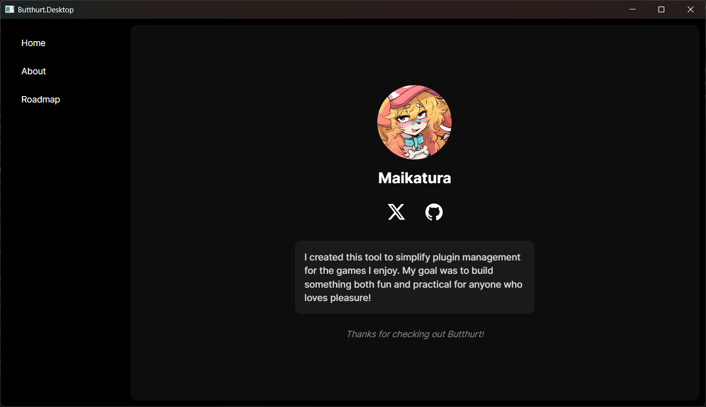

# Butthurt

Make your toy react to what happens in your game or on your stream.
Take damage in World of Warcraft? It buzzes. Someone cheers bits on Twitch? It buzzes.



> **New version in progress.** This is a full remake with a proper window instead of a console.
> Looking for the old console version? It's [here](https://github.com/Maikatura/Butthurt).

## What it can do

- **World of Warcraft** – react to 15 in-game events: damage, heals, stuns, combat, dying, level ups, quests,
  boss pulls and kills, PvP kills, ready checks, whispers and more. Make as many rules as you like.
- **Twitch** – buzz on bits, subs, gifted subs, channel point redeems, follows, raids and chat commands.
- **Fansly** – buzz on tips, subs and chat commands in your livestream.
- **VRChat** – let Twitch and Fansly swap your avatar or make you grow and shrink, and let your avatar's
  contacts (headpats, boops, toggles) buzz your toys or the PiShock.
- **PiShock** – vibrate, beep or shock from Twitch, Fansly, WoW and VRChat (with safety limits you set).
- **Stream overlay** – show announcements and the queue of running effects in OBS (turn it on under **Settings → Plugins**).

You decide what triggers what and how strong it feels, all inside the app. No coding needed.

## Getting started

1. **Download Butthurt** from the [Releases page](../../releases) and unzip it anywhere.
2. **Install [Intiface Central](https://intiface.com/central/)**, open it and press **Start Server**.
3. **Turn on your toy** and connect it in Intiface Central.
4. **Open `Butthurt.exe`.**
5. Go to the page you want (World of Warcraft, Twitch, …) and follow the steps there.
   There's also a **Guide** page inside the app.

### World of Warcraft quick setup

1. On the **World of Warcraft** page, press **Find it** (or pick your game folder), then **Install**.
2. Press **Start** on the Home page.
3. In WoW, set the display to **Windowed (Fullscreen)** and type `/reload`.
4. Type `/butthurt test` to feel it without having to die. `/butthurt` opens the settings.
5. Add **Toy rules** (and **PiShock rules**) for the events you want on the World of Warcraft page.

The game needs to be the active window for it to work. After updating Butthurt, press **Reinstall** on the
World of Warcraft page once so the addon knows the newest events.

### Just streaming, no toys?

Go to **Settings → Plugins** and turn off **Toys** (and PiShock or World of Warcraft if you don't need
them). Vibration rules sit out and Butthurt becomes a stream/VRChat tool. Turn them back on any time.

## Common questions

**Is it safe? Does it ask for my password?**
No passwords. Twitch login happens in your own browser. PiShock uses an API key you make on their site.

**Twitch login says it needs a Client ID?**
Make a free app at [dev.twitch.tv/console/apps](https://dev.twitch.tv/console/apps)
(category *Application Integration*, type *Public*, redirect URL `http://localhost`) and paste its Client ID on the Twitch page.

**Fansly stopped working?**
Fansly has no official way to do this, so a change on their side can break it until Butthurt is updated.

**My game doesn't react.**
Make sure WoW is in *Windowed (Fullscreen)*, the addon is installed, you pressed **Start**, and Intiface Central is running.

---

## Building it yourself (for developers)

You need Windows and the [.NET 9 SDK](https://dotnet.microsoft.com/download/dotnet/9.0).

```powershell
git clone https://github.com/Maikatura/Butthurt.git
cd Butthurt
dotnet run --project Butthurt.Desktop
```

To make a standalone `.exe` (no .NET install needed to run it):

```powershell
dotnet publish Butthurt.Desktop -c Release -r win-x64 --self-contained true -p:PublishSingleFile=true -o publish
```

**How the code is laid out:** every game, site or device is its own project (`Butthurt.Warcraft`, `Butthurt.Twitch`,
`Butthurt.Toys`, …). `Butthurt.Contracts` is the shared core with the `IPlugin` interface, and `Butthurt.Desktop`
is the app window. To add something new, copy a plugin project, implement `IPlugin` and register it in `MainWindow`.

**Releases:** pushing a tag like `v0.2.0` builds the app on GitHub and puts it on the Releases page.
Tags with a dash (`v0.2.0-beta`) become pre-releases.
